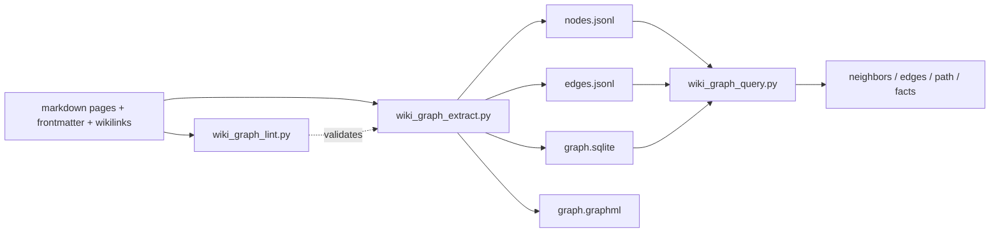

<!-- Adapted from: docs/graph.html (source: skills/info-hive/references/graph-workflow.md). -->

# グラフ層

wiki の Markdown から、必要に応じてグラフを作れます。グラフがあると、関係の種類と出典を持つ「型付きエッジ」を、プログラムから調べられます。正本は Markdown です。グラフはページから作り直せます。

> グラフ層はオプトイン方式です。`wiki/graph/ontology.yaml` がなければ、その wiki はグラフ層を導入する前の状態です。extract、lint、query のスクリプトは、どれも何も書き出さずに終了コード 1 で止まります。オントロジーのファイルをでっち上げてはなりません。先にグラフ層を初期化する（[`/wiki:graph`](./commands.md#wikigraph-action) または [`/wiki:init`](./commands.md#wikiinit) を使う）か、グラフ層なしで進めます。

正本は Markdown のページです。次の図にある生成物は、いつでも削除して作り直せます。



## グラフが表すもの

extract を実行すると、次の3種類のエッジができます。

1. **型付きの意味のエッジ。** ページの frontmatter の `graph.relationships[]` で宣言したもの（`founded`、`proposed`、`depends_on` など）。どのエッジも、明示的な `source`（ソースページのスラッグ）、`evidence` の引用、`confidence`（high/medium/low）、`status`（current/historical/proposed/disputed/superseded）を持ちます。抽出スクリプトがこれらを勝手に作ることはありません。
2. **`mentions` エッジ。** 本文の `[[wikilink]]` 1つにつき1本で、ページ内の重複はまとめられ、確信度は `low` になります。目的のページを早く見つけるためのもので、型付きの関係の証拠にはなりません。
3. **`sourced_from` と `summarizes_raw` のエッジ。** 前者はソースページ以外のページの `sources:` リストからソースページへ、後者はソースページの `raw:` フィールドから raw ファイルへ張られます。

## frontmatter のスキーマ

型付きの関係は、ページの frontmatter に書きます。

```yaml
graph:
  node_id: person:praney-behl       # 任意。既定は <node_type>:<slug>
  node_type: person                 # 任意。既定はオントロジーの対応付けで決まる
  canonical: true                   # 複数のスラッグが1つのエンティティの別名になっている場合
  aliases: [Praney, praney@example.com]
  relationships:
    - predicate: founded
      object: company:seedblocks
      source: praney-founder-context-dump
      evidence: "Solo technical founder and sole director..."
      confidence: high
      status: current
```

関係に必須のフィールドは `predicate`、`object`、`source`、`evidence`、`confidence`、`status` です。`node_id` は `<node_type>:<slug>` の形をとります。

## オントロジー

`wiki/graph/ontology.yaml` は、グラフの仕様を決めるファイルです。`node_types[*].maps_from`（ページの `type` や `kind` をどのノード種別に対応させるか）と、`predicates[*]`（使える述語と、その `subject_types`、`object_types`、`requires_evidence`）を宣言します。`"*"` はワイルドカードです。分野固有の述語を追加するときはオントロジーを編集し、lint を再実行して、既存のエッジがオントロジーに合っているかを検証します。

## 型付きエッジと通常の wikilink の使い分け

特定のソースが関係をはっきり述べていて、証拠を引用でき、その述語が後のクエリで意味を持つなら、**型付きエッジ**を追加します。関係が暗黙的なもの、1つの引用に結びつけられないもの、`mentions` エッジにしかならないものには、通常の **`[[wikilink]]`** を使います。迷ったら wikilink を使います。lint は証拠の欠落を指摘するが、関係を控えめに書いたことを問題にはしません。

## extract、lint、query

```bash
# まず型付きメタデータを検証する。lint はファイルを編集しない。
uv run --script skills/info-hive/scripts/wiki_graph_lint.py wiki/

# nodes.jsonl、edges.jsonl、graph.sqlite、graph.graphml にコンパイルする。
uv run --script skills/info-hive/scripts/wiki_graph_extract.py wiki/

# グラフをたどる。
python skills/info-hive/scripts/wiki_graph_query.py wiki/ neighbors --node product:konvy
python skills/info-hive/scripts/wiki_graph_query.py wiki/ edges    --subject person:stephanie-emmanouel
python skills/info-hive/scripts/wiki_graph_query.py wiki/ path     --from person:praney-behl --to product:konvy
python skills/info-hive/scripts/wiki_graph_query.py wiki/ facts    --about product:konvy
```

`--json` は lint と query のどちらのコマンドでも使えます。同じ操作は、スラッシュコマンドの [`/wiki:graph`](./commands.md#wikigraph-action) からも実行できます。回答では、必ず wiki ページとその raw ソースを出典として示します。グラフは読むページを探すために使い、根拠は該当するページとその原本で確認します。

## 生成物の扱い

| ファイル | 正本か | 既定の管理方法 |
| --- | --- | --- |
| `ontology.yaml` | 正本です。手で編集します。 | git で管理します。 |
| `nodes.jsonl` | 生成物 | 任意。PR でグラフの差分を確認したい場合は、git で管理します。 |
| `edges.jsonl` | 生成物 | 任意。上と同じ |
| `graph.sqlite` | 生成物 | 既定で gitignore する（大きいバイナリのため） |
| `graph.graphml` | 生成物 | 既定で gitignore する |

> グラフの lint と抽出は、PyYAML 6.0.3 にバージョンを固定したメタデータを持ち、`uv run --script` で実行されます。手作業での `pip install` は不要です。グラフのクエリは Python の標準ライブラリだけを使います。
