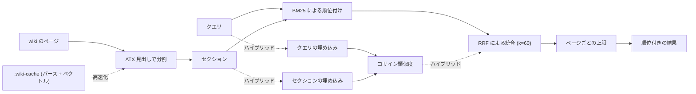

<!-- Source: v3 local hybrid design: FastEmbed, sqlite-vec, BM25/RRF, JSON evidence, and incremental caches. -->

# 検索と取得

v3.0.0 では、セクション単位のハイブリッド検索がローカルで動く既定の検索になった。FastEmbed がセマンティックなベクトルを生成し、sqlite-vec がそれを保存して順位を付け、BM25 が語の完全一致による精度を保ち、RRF が両方の結果リストを統合する。構造化された `--json` の証拠行と、内容のハッシュで管理する差分更新のキャッシュは、これまでと変わらない。

検索スクリプトは、インデックスの1行の要約から適切な候補が見つからないときの代わりの手段である（[クエリのワークフロー](./workflows.md#wiki-にクエリする)を参照）。リポジトリのルートで実行する。

```bash
uv run --script skills/info-hive/scripts/wiki_search.py "attention mechanism" --wiki wiki --json
```



## セクション単位の結果

既定（`--granularity section`）では、スクリプトは各ページを ATX 見出しで分割し、得られたセクションに BM25 で順位を付ける。1ページから採るセクションは最大 `--per-page` 件（既定は 2）までとし、`--top` 件の結果が集まるまで続ける。各セクションのスコアは、タイトル、見出しのパス、本文を対象に計算する。これは、長いページの中での一致をより正確にするための、文脈つき BM25 のプレフィックスである。

順位付けの定数は v1 から変わっていない（BM25 で `k1=1.5`、`b=0.75`）。

## JSON の証拠行

`--json` フラグを付けると、機械可読なオブジェクトを1つ標準出力に出す。エージェントやほかのツールに渡すのに向いている。

```json
{
  "query": "attention mechanism",
  "wiki": "wiki",
  "granularity": "section",
  "mode": "lexical",
  "results": [
    {
      "slug": "attention-mechanism",
      "rel_path": "concepts/attention-mechanism.md",
      "type": "concept",
      "title": "Attention Mechanism",
      "heading_path": ["Attention Mechanism", "Variants"],
      "section_index": 2,
      "score": 8.42,
      "retrievers": ["bm25"],
      "snippet": "...",
      "updated": "2026-01-20",
      "tags": ["attention"],
      "sources": ["attention-paper"],
      "neighbors": {"prev": "Scaled dot-product", "next": "Cross-attention"}
    }
  ]
}
```

| フィールド | 意味 |
| --- | --- |
| `heading_path` | 一致したセクションの見出しの階層（祖先の見出しから順に並び、このセクションの見出しで終わる）。ページ単位では空。 |
| `section_index` | ページ内でのセクションの位置。ページ単位では `null`。 |
| `score` | BM25 のスコア（ハイブリッドモードでは RRF のスコア）。小数点以下 4 桁に丸める。 |
| `retrievers` | この行を見つけた検索器: `["bm25"]`、`["embedding"]`、またはその両方。 |
| `snippet` | セクションの本文。空白をまとめたうえで、先頭 400 文字。 |
| `updated`、`tags`、`sources` | frontmatter の値をそのまま使う（ない場合は `null` / `[]`）。 |
| `neighbors` | 同じページで隣り合うセクションの見出し（ページの先頭や末尾では `null`）。 |

セマンティック検索の候補は、RRF の前に、控えめに設定したコサイン類似度の下限も超える必要がある。これにより、無関係なベクトルの近傍のせいで、wiki の範囲外の質問に、いかにも確かそうな結果が返ることを防ぐ。BM25 の完全一致には影響しない。

`--json` を付けなければ、結果はこれまでどおりの人が読む形式で出力される。セクションが一致した行には、見出しのパスを示す `§` の行が付く。

## ページ全体の順位付け

`--granularity page` を指定すると、v1 とまったく同じ方法でページ全体に順位を付ける。v2 より前の動作をバイト単位で再現する。ページ単位の行は、`heading_path` が空で `section_index` が `null` になり、常に語彙ベースの検索になる（埋め込みはセクション単位でだけ使われる）。

```bash
python skills/info-hive/scripts/wiki_search.py "attention mechanism" --wiki wiki --granularity page --no-embed --json
```

## フィルター

frontmatter のフィルターで結果を絞り込める。フィルターはすべて組み合わせられる。

```bash
uv run --script skills/info-hive/scripts/wiki_search.py "diffusion" --wiki wiki \
  --type concept --tag generative --since 2026-01-01 --top 10 --per-page 3
```

リンクを対象にした2つのモードは、v1 のテキスト出力のままである。`--backlinks <slug>` は被リンクを、`--top-linked N` は wiki のハブページを見つける。

## パースキャッシュ

`--cache` フラグを付けると、差分更新のパースキャッシュを使う。これにより、大きな wiki でも検索のたびに全ページをパースし直さずに済む。値を省略すると `wiki/.wiki-cache/search-index.json` を使い、パスを指定すればその場所を使う。

```bash
# 既定のキャッシュの場所を使う
uv run --script skills/info-hive/scripts/wiki_search.py "attention" --wiki wiki --json --cache

# またはパスを明示する
uv run --script skills/info-hive/scripts/wiki_search.py "attention" --wiki wiki --json --cache /tmp/idx.json
```

各ファイルは、生のバイト列の SHA-256 をキーにして管理する。変わっていないファイルはキャッシュを再利用し、変わったファイルはパースし直し、削除されたファイルはキャッシュから除く。キャッシュがない、パースできない、古いスキーマのものである、といった場合は一から作り直し、標準エラー出力に `cache: rebuilding (<reason>)` を1行出す。キャッシュはアトミックに書き込まれる。

> **結果が同じであることを保証**
>
> 同じクエリなら、`--cache` の有無にかかわらず `--json` の出力はバイト単位で同じになる。キャッシュが変えるのは速度だけで、順位は変えない。この不変条件は、評価用のハーネスで確かめている。

## 既定のローカルのハイブリッド検索

セクションの検索では、FastEmbed で `BAAI/bge-small-en-v1.5` を使い、その 384 次元のベクトルを sqlite-vec の仮想テーブルに保存する。BM25 とセマンティック検索の順位は、Reciprocal Rank Fusion（RRF、`k=60`、重みは等しい）で統合する。API キーや外部のサービスは使わず、wiki のセクションとクエリのテキストがマシンの外に出ることはない。

スクリプトは、バージョンを固定した [PEP 723](https://peps.python.org/pep-0723/) の依存関係を宣言している。`uv` で実行すれば、プロジェクトの環境を変えずに、それらのパッケージを使える。

```bash
uv run --script skills/info-hive/scripts/wiki_search.py \
  "how does self-attention weigh tokens" --wiki wiki --json --top 5
```

初期化とアップグレードのたびに `setup_wiki.py` が実行される。FastEmbed のモデルのファイルは `~/.cache/info-hive/fastembed/` にキャッシュされ（`FASTEMBED_CACHE_PATH` で変更できる）、現在のすべてのセクションが `wiki/.wiki-cache/embeddings.sqlite` に同期される。以降の検索とアップグレードでは、新しいセクションや変更されたセクションだけをベクトル化し、削除されたセクションは取り除く。

ハイブリッドモードでは、JSON の `mode` が `"hybrid"` になり、各行の `retrievers` フィールドで、BM25、埋め込み、その両方のどれがその行を見つけたかが分かる。

> **失敗しても検索は壊れない**
>
> FastEmbed が使えない、モデルの初期化に失敗した、sqlite-vec を読み込めない、といった場合、コマンドは機密情報を含まない警告を標準エラー出力に出し、BM25 に切り替え、`mode: "lexical"` で終了コード 0 で終わる。依存パッケージを使わない方法を明示的に選ぶには、PEP 723 による解決を経由せずに `python skills/info-hive/scripts/wiki_search.py "<query>" --no-embed` を実行する。

## キャッシュディレクトリ

`wiki/.wiki-cache/` には、互いに独立していて、いつでも完全に再生成できる2つのインデックスがある。

| ファイル | 用途 |
| --- | --- |
| `search-index.json` | `--cache` が使う、パース済みのページとセクションのキャッシュ。 |
| `embeddings.sqlite` | セクションの位置情報、内容のハッシュ、sqlite-vec のベクトル。 |

どちらも gitignore の対象で、削除してかまわない。次のクエリで、ないものが作り直される。モデル、次元数、ベクトルのスキーマが変わったときも、`embeddings.sqlite` は自動的に作り直される。プロバイダーを使っていた旧来の `embeddings.jsonl` キャッシュは無視されるので、削除してよい。

## 任意の関連度ゲート

任意の[判定レイヤー](./decisions.md)を有効にしていれば、`--decide` を付けると、上位 20 のセクションのそれぞれがクエリに答える役に立つかを、小さな判定モデルに問い合わせる。閾値を下回る行は除かれる。その結果が空なら、wiki にはおそらく答えがないということである。

```bash
uv run --script skills/info-hive/scripts/wiki_search.py "query" --wiki wiki --json --decide
```

JSON には、トップレベルの `decision` ブロック（バックエンド、モデル、閾値、候補の数、残した数、除いた数、`failed_open`、レイテンシー）と、各行の `decision` フィールドが加わる。バックエンドが失敗した場合、検索は `failed_open: true` を付けて通常の行を返す。`--decide` を付けなければ、出力は変わらない。
