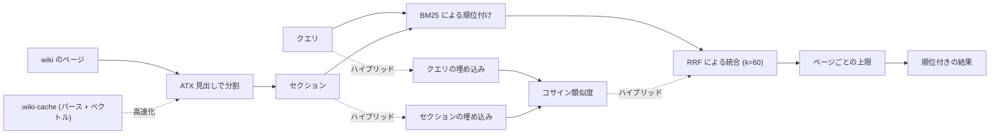

<!-- Source: v3 local hybrid design: FastEmbed, sqlite-vec, BM25/RRF, JSON evidence, and incremental caches. -->

# 検索と取得

v3.0.0 で、手元で動くハイブリッド検索が、セクション単位の既定の検索方式になりました。FastEmbed が意味検索用のベクトルを作り、sqlite-vec が保存して順位を付けます。BM25 は語彙の一致に基づいて順位を付けます。最後に RRF が両方の検索結果を統合します。構造化された `--json` の証拠行と、内容のハッシュで管理する差分更新のキャッシュは、これまでと変わりません。

インデックスの 1 行の要約から候補が見つからなければ、検索スクリプトをリポジトリのルートで実行します。[wiki に質問する手順](./workflows.md#wiki-にクエリする)で、検索を使う場面を確認できます。

```bash
uv run --script skills/info-hive/scripts/wiki_search.py "attention mechanism" --wiki wiki --json
```



## セクション単位の結果

既定（`--granularity section`）では、スクリプトは各ページを ATX 見出しで分割し、得られたセクションに BM25 で順位を付けます。1ページから採るセクションは最大 `--per-page` 件（既定は 2）までとし、`--top` 件の結果が集まるまで続けます。各セクションのスコアは、タイトル、見出しのパス、本文を対象に計算します。これは、長いページの中での一致をより正確にするための、文脈つき BM25 のプレフィックスです。

順位付けの定数は v1 と同じです。BM25 では `k1=1.5`、`b=0.75` を使います。

## JSON の証拠行

`--json` フラグを付けると、機械可読なオブジェクトを1つ標準出力に出します。エージェントやほかのツールに渡すのに向いています。

```json
{
  "query": "attention mechanism",
  "wiki": "wiki",
  "granularity": "section",
  "mode": "lexical",
  "results": [
    {
      "slug": "attention-mechanism",
      "rel_path": "concepts/attention-mechanism.md",
      "type": "concept",
      "title": "Attention Mechanism",
      "heading_path": ["Attention Mechanism", "Variants"],
      "section_index": 2,
      "score": 8.42,
      "retrievers": ["bm25"],
      "snippet": "...",
      "updated": "2026-01-20",
      "tags": ["attention"],
      "sources": ["attention-paper"],
      "neighbors": {"prev": "Scaled dot-product", "next": "Cross-attention"}
    }
  ]
}
```

| フィールド | 意味 |
| --- | --- |
| `title` | いつも文字。frontmatter の `title` を配列で書いたもの（`title: [WIP]`）は、空でない要素を「, 」でつなぎます。ない場合や値が空の場合は、ページのスラッグ。 |
| `heading_path` | 一致したセクションの見出しの階層（祖先の見出しから順に並び、このセクションの見出しで終わる）。ページ単位では空。 |
| `section_index` | ページ内でのセクションの位置。ページ単位では `null`。 |
| `score` | BM25 のスコア（ハイブリッドモードでは RRF のスコア）。小数点以下 4 桁に丸めます。 |
| `retrievers` | この行を見つけた検索器: `["bm25"]`、`["embedding"]`、またはその両方。 |
| `snippet` | セクションの本文。空白をまとめたうえで、先頭 400 文字。 |
| `type`、`updated` | 文字か `null`。文字はそのまま使います。frontmatter に配列で書いたもの（`type: [concept]`、`updated: [2026-03-01]`）は、空でない要素を「, 」でつなぎます。`type` の要素は、日本語の別名（`概念` など）を英語に直します。ない場合や空の配列は `null`。`--type` と `--since` の絞り込みも、この値で比べます。 |
| `tags`、`sources` | いつも文字の配列。frontmatter に値を 1 つだけ書いたもの（`tags: 検索`）は 1 要素の配列にし、要素の前後の空白と空の要素は除きます。ない場合や値が空の場合は `[]`。 |
| `neighbors` | 同じページで隣り合うセクションの見出し（ページの先頭や末尾では `null`）。 |

セマンティック検索の候補は、RRF の前に、控えめに設定したコサイン類似度の下限も超える必要があります。これにより、無関係なベクトルの近傍のせいで、wiki の範囲外の質問に、いかにも確かそうな結果が返ることを防ぎます。BM25 の完全一致には影響しません。

`--json` を付けなければ、結果はこれまでどおりの人が読む形式で出力されます。セクションが一致した行には、見出しのパスを示す `§` の行が付きます。

## ページ全体の順位付け

`--granularity page` を指定すると、v1 とまったく同じ方法でページ全体に順位を付けます。v2 より前の動作をバイト単位で再現します。ページ単位の行は、`heading_path` が空で `section_index` が `null` になり、常に語彙ベースの検索になります。埋め込みを使うのは、セクション単位で検索するときだけです。

```bash
python skills/info-hive/scripts/wiki_search.py "attention mechanism" --wiki wiki --granularity page --no-embed --json
```

## フィルター

frontmatter のフィルターで結果を絞り込めます。フィルターはすべて組み合わせられます。

```bash
uv run --script skills/info-hive/scripts/wiki_search.py "diffusion" --wiki wiki \
  --type concept --tag generative --since 2026-01-01 --top 10 --per-page 3
```

リンクを対象にした2つのモードは、v1 のテキスト出力のままです。`--backlinks <slug>` は被リンクを、`--top-linked N` は wiki のハブページを見つけます。

## パースキャッシュ

`--cache` フラグを付けると、差分更新のパースキャッシュを使います。これにより、大きな wiki でも検索のたびに全ページをパースし直さずに済みます。値を省略すると `wiki/.wiki-cache/search-index.json` を使い、パスを指定すればその場所を使います。

```bash
# 既定のキャッシュの場所を使う
uv run --script skills/info-hive/scripts/wiki_search.py "attention" --wiki wiki --json --cache

# またはパスを明示する
uv run --script skills/info-hive/scripts/wiki_search.py "attention" --wiki wiki --json --cache /tmp/idx.json
```

各ファイルは、生のバイト列の SHA-256 をキーにして管理します。変わっていないファイルはキャッシュを再利用し、変わったファイルはパースし直し、削除されたファイルはキャッシュから除きます。キャッシュがない、パースできない、古いスキーマのものである、といった場合は一から作り直し、標準エラー出力に `パースキャッシュを作り直す（<理由>）` を1行出します。キャッシュはアトミックに書き込まれます。

リンクなどでキャッシュの経路や書き込みが拒まれた場合は、記事を読み直して検索を続けます。場所と理由を JSON の `link_warnings` と標準エラーに出します。

> **結果が同じであることを保証**
>
> 同じクエリなら、`--cache` の有無にかかわらず結果の順位と内容は同じになります。キャッシュの警告がなければ `--json` の出力もバイト単位で一致します。この不変条件は、評価用のハーネスで確かめています。

## 既定のローカルのハイブリッド検索

セクションの検索には、FastEmbed と多言語モデル `intfloat/multilingual-e5-small` を使います。モデルは fp16 の ONNX 形式で、ダウンロードは約 0.25 GB です。生成した 384 次元のベクトルは、sqlite-vec の仮想テーブルに保存します。e5 系のモデルが学習時に使った形式に合わせ、クエリには `query: `、セクションには `passage: ` を付けてから埋め込みます。コサイン距離が 0.193 を超えるセクションは、埋め込み検索の結果に含めません。BM25 とセマンティック検索の順位は、Reciprocal Rank Fusion（RRF、`k=60`、重みは等しい）で統合します。API キーや外部のサービスは使わず、wiki のセクションとクエリのテキストがマシンの外に出ることはありません。

スクリプトは、バージョンを固定した [PEP 723](https://peps.python.org/pep-0723/) の依存関係を宣言しています。`uv` で実行すれば、プロジェクトの環境を変えずに、それらのパッケージを使えます。

```bash
uv run --script skills/info-hive/scripts/wiki_search.py \
  "how does self-attention weigh tokens" --wiki wiki --json --top 5
```

初期化とアップグレードのたびに `setup_wiki.py` が実行されます。FastEmbed のモデルのファイルは `~/.cache/info-hive/fastembed/` にキャッシュされ（`FASTEMBED_CACHE_PATH` で変更できる）、現在のすべてのセクションが `wiki/.wiki-cache/embeddings.sqlite` に同期されます。以降の検索とアップグレードでは、新しいセクションや変更されたセクションだけをベクトル化し、削除されたセクションは取り除きます。

ハイブリッドモードでは、JSON の `mode` が `"hybrid"` になり、各行の `retrievers` フィールドで、BM25、埋め込み、その両方のどれがその行を見つけたかが分かります。

> **失敗しても検索は壊れない**
>
> FastEmbed が使えない、モデルの初期化に失敗した、sqlite-vec を読み込めない、といった場合、コマンドは機密情報を含まない警告を標準エラー出力に出し、BM25 に切り替え、`mode: "lexical"` で終了コード 0 で終わります。依存パッケージを使わない方法を明示的に選ぶには、PEP 723 による解決を経由せずに `python skills/info-hive/scripts/wiki_search.py "<query>" --no-embed` を実行します。

### 埋め込みモデルを切り替える

環境変数 `INFO_HIVE_EMBED_MODEL` で埋め込みモデルを選べます。選べるのは `wiki_search.py` の `EMBED_MODELS` に載っているモデルだけで、載っていない名前を指定すると、警告を出して語彙ベースの検索に切り替わります。モデルを変えると、`embeddings.sqlite` は次の検索で自動的に作り直されます。英語専用のモデルは置いていません。

`embeddings.sqlite` と SQLite の付随ファイルへの経路を検査し、リンクや権限などで索引を書けない場合は、警告を出して BM25 の語彙検索を返します。初期化やアップグレード時のセットアップが同じ理由で索引を準備できなければ、`status: lexical` を返します。

| モデル | ダウンロード | 次元数 | 距離の上限 | 評価セットでの recall@10（日本語 / 英語） |
|---|---|---|---|---|
| `intfloat/multilingual-e5-small`（既定） | 約 0.25 GB | 384 | 0.193 | 1.000 / 0.926 |
| `intfloat/multilingual-e5-large` | 約 2.24 GB | 1024 | 0.19 | 1.000 / 0.815 |

`multilingual-e5-large` は、評価セットでは日本語の MRR が既定のモデルより少し高い（0.975 と 0.954）が、英語の recall@10 は低く、セクションの埋め込みは 7 倍ほど時間がかかります。重みを `model.onnx_data` に分けて配布しているので、`wiki_search.py` は fastembed を読み込む前に `HF_HUB_DISABLE_SHARED_BLOBS=1` を設定します。huggingface_hub 1.33 の既定では、大きいファイルの実体をキャッシュ全体で共有する置き場所に置くため、onnxruntime 1.31 が `model.onnx_data` を「モデルのディレクトリの外にある」として読み込めません。この設定の前にダウンロードしたモデルで読み込みに失敗するときは、`~/.cache/info-hive/fastembed/` からそのモデルのディレクトリを消して、ダウンロードし直します。

## 日本語のトークン化

BM25 のトークンは、テキストを NFKC で正規化して小文字にしたあと、文字種（英数字、漢字、ひらがな、カタカナ）の境界で区切って作ります。

- 英数字は語単位で切り出します。英数字だけのテキストのトークンは、移植元の llm-wiki と変わりません。
- かなと漢字は、2 文字ずつ重ねて切り出します。これを文字 bigram と呼びます。1 文字だけの並びは 1 文字のトークンにします。
- 漢字は 1 文字単位のトークンも加えます。そのため、「税」のような単漢字のクエリが「消費税」を含むページに当たります。
- 全角の英数字と半角のカタカナは、NFKC で半角の英数字と全角のカタカナにそろえます。

文字 bigram では、関係のないページにも偶然一致することがあります。そこで、日本語のトークンを含むクエリでは、クエリのトークンのうちページに現れるものの割合（IDF で重みを付けた被覆率）が 0.25 に満たないページを、語彙ベースの結果から外します。英数字だけのクエリには、この制限をかけません。形態素解析（SudachiPy など）は使いません。評価セットで比べたところ、文字 bigram より明らかに良いとはいえませんでした。

語彙側のトークンが 1 つもないクエリ（記号だけのクエリなど）でも、ハイブリッド検索では埋め込み検索を行います。`--no-embed` やページ単位の検索では、空の結果を返します。

## キャッシュディレクトリ

`wiki/.wiki-cache/` には、互いに独立していて、いつでも完全に再生成できる2つのインデックスがあります。

| ファイル | 用途 |
| --- | --- |
| `search-index.json` | `--cache` が使う、パース済みのページとセクションのキャッシュ。 |
| `embeddings.sqlite` | セクションの位置情報、内容のハッシュ、sqlite-vec のベクトル。 |

どちらも gitignore の対象で、削除してかまいません。次のクエリで、ないものが作り直されます。モデル、次元数、ベクトルのスキーマが変わったときも、`embeddings.sqlite` は自動的に作り直されます。プロバイダーを使っていた旧来の `embeddings.jsonl` キャッシュは無視されるので、削除できます。

## 任意の関連度ゲート

任意の[判定レイヤー](./decisions.md)を有効にしていれば、`--decide` を付けると、上位 20 のセクションのそれぞれがクエリに答える役に立つかを、小さな判定モデルに問い合わせます。閾値を下回る行は除かれます。その結果が空なら、wiki にはおそらく答えがないということです。

```bash
uv run --script skills/info-hive/scripts/wiki_search.py "query" --wiki wiki --json --decide
```

JSON には、トップレベルの `decision` ブロック（バックエンド、モデル、閾値、候補の数、残した数、除いた数、`failed_open`、レイテンシー）と、各行の `decision` フィールドが加わります。バックエンドが失敗した場合、検索は `failed_open: true` を付けて通常の行を返します。`--decide` を付けなければ、出力は変わりません。
