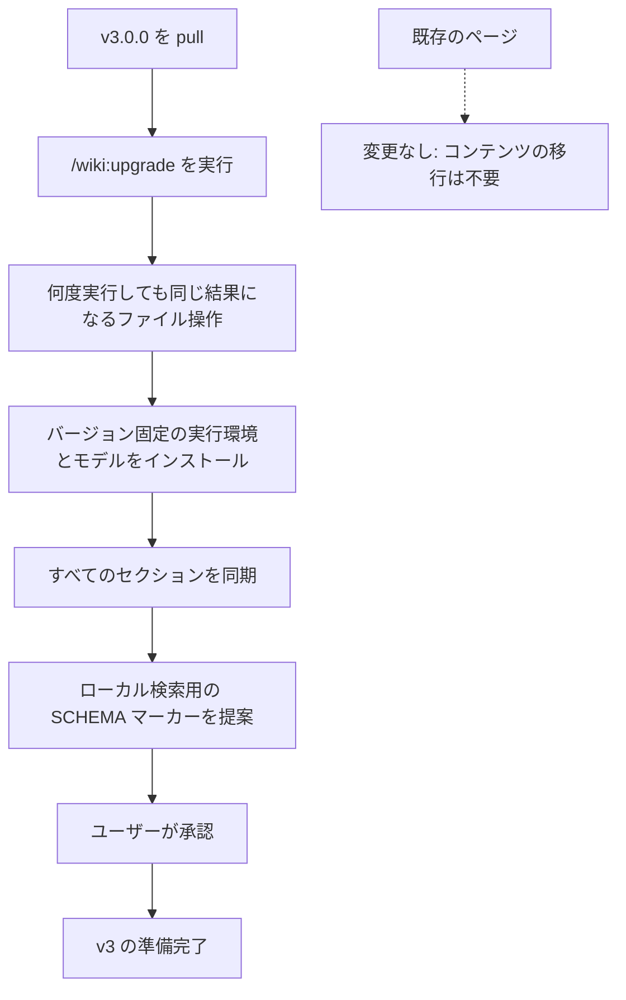

<!-- Adapted from: commands/upgrade.md. -->

# アップグレード

ここでは、移植元 llm-wiki-plugin の変更点と、以前の版からのアップグレード手順を説明します。版は、とくに断らない限り移植元のものです。info-hive は移植元の v4.0.1 を起点にしています。詳しくは[移植元の記録](../UPSTREAM.md)を参照してください。info-hive で作った wiki には、[規約とテンプレートの更新手順](html/howto-upgrade-wiki.html)を使います。移植元の v4.0.0 で加わったホスト型 wiki は、info-hive には含めていません。

## 移植元の v4.0.0 で変わった点

v4.0.0 では、オプションの判定レイヤーが加わりました。ローカルの wiki、ページの形式、ローカルの検索、すべてのコマンドは、これまでどおり動きます。メジャーバージョンを上げたのは、Paperclip 連携を削除したためです。

- **ローカルの wiki に移行作業は要りません。** `wiki/` の下は何も変わりません。ローカルの検索、lint、グラフ、改善のスクリプトも同じです。
- **判定モデル（オプション、既定では無効）。** 小さなモデルを使って、検索結果を関連度でふるい分けたり、グラフの証拠を確かめたり、信頼できないテキストを選別したりできます。詳しくは[判定モデル](./decisions.md)を参照してください。
- **Paperclip 連携の削除。** `integrations/paperclip/` のプラグインとそのドキュメントはなくなりました。npm パッケージは一度もレジストリに公開していないので、レジストリ側での対応は不要です。Paperclip が必要なら、移植元の v3.2.x を使い続けます。v3.2.0 のドキュメントは、移植元のリポジトリの [`docs/v3`](https://github.com/praneybehl/llm-wiki-plugin/tree/2d24ccf/docs/v3) にあります。

## アップグレードの手順

1. インストールしたときと同じ方法で、**プラグインまたはスキルを更新します。**Claude Code では、マーケットプレイスからのインストールをもう一度実行します。スキルだけを使うエージェントでは、`npx skills add` をもう一度実行します。
2. wiki に対して **`/wiki:upgrade` を実行します。**v3.2 と同じ、何度実行しても同じ結果になるファイル操作と、実行環境のチェックを行います。移植元の v4.0.0 では、`SCHEMA.md` に新しく加えるべきセクションはありません。info-hive の 0.8.0 では、ソースの要約ページの主張と行き先の表を記した `## Claim destinations` のセクションが加わったので、`/wiki:upgrade` がそのマージを案内します。

## v3.2 より前からのアップグレード

v3.2.0 では、オプションの経験の記録と、評価済みのスキルの改善が加わりました。既存の wiki、frontmatter、CLI のフラグは、引き続き互換性があります。バックグラウンドで動く最適化の仕組みが有効になることはありません。

設定した wiki に対して `/wiki:upgrade` を実行します。既存の実行環境のセットアップは、引き続き必須です。アップグレードでは、`.experience-template.json`、`.pattern-template.md`、`.evolution/README.md` を、ない場合にだけ追加します。カスタマイズしたファイルと SCHEMA.md は保持されます。レビュー用に、オプションの `## Skill evolution` スキーマセクションを提案します。

検証済みのタスクの経験には `/wiki:learn` を、根拠にもとづく改善案と、測定にもとづく採用には `/wiki:evolve` を使います。アップグレードの間に評価やスキルの置き換えが行われることはありません。`.evolution/` は、いつでも作り直せる `.wiki-cache/` と違い、消えては困る履歴なのでバックアップしておきます。ランナーの仕様、パイロットスイート、推論の予算、ロールバックについては[経験の記録とスキルの改善](./evolution.md)を参照してください。

## v3.0 より前からのアップグレード


v3.0.0 では、プロバイダーを使った埋め込みが、既定のローカルの FastEmbed と sqlite-vec による検索に置き換わりました。既存の Markdown には手を付けず、変わるのはいつでも作り直せるベクトルインデックスだけです。

> **コンテンツの移行は不要**
>
> ページと frontmatter の形式は変わっていません。古い `embeddings.jsonl` キャッシュは無視されるので、削除してかまいません。`/wiki:upgrade` が `embeddings.sqlite` をローカルに作り、現在あるすべてのセクションを同期します。



## メジャーバージョンを上げた理由

既定のセクション検索は、プロバイダーを設定しない限り語彙ベースのままだったが、ローカルのモデルと sqlite-vec のインデックスを初期化するようになりました。データはローカルの外に出なくなり、プロバイダー用の古い環境変数と承認フラグは削除されました。`python wiki_search.py "<query>" --no-embed` で直接実行すれば、依存パッケージを使わない BM25 を引き続き使えます。

## アップグレードの手順

1. **現在のリリースを取得します。** インストールしたときと同じ方法でプラグインを更新します。Claude Code では、マーケットプレイスからのインストールをもう一度実行します。スキルだけを使うエージェントでは、`npx skills add` をもう一度実行します。
2. **アップグレードを実行します。** Claude Code では次のコマンドを実行します。

   ```bash
   /wiki:upgrade
   ```

   直接実行する場合は、インストール済みのスクリプトと、選んだベースディレクトリを別々に渡します。プロジェクトの wiki の場合:

   ```bash
   python "${CLAUDE_PLUGIN_ROOT}/skills/info-hive/scripts/init_wiki.py" "<absolute-project-root>" --upgrade
   ```

   ユーザースコープの標準の構成の場合:

   ```bash
   python "${CLAUDE_PLUGIN_ROOT}/skills/info-hive/scripts/init_wiki.py" "<absolute-home-directory>/info-hive" --upgrade
   ```

   以前の既定（`~/wiki/` と `~/wiki/raw/`）で作った wiki は移動せず、ベースディレクトリとサブディレクトリをそのまま指定する:

   ```bash
   python "${CLAUDE_PLUGIN_ROOT}/skills/info-hive/scripts/init_wiki.py" "<absolute-home-directory>" --wiki-dir wiki --raw-dir wiki/raw --upgrade
   ```

   スキルだけをインストールしている場合は、`${CLAUDE_PLUGIN_ROOT}/skills/info-hive` を、そのエージェントにインストールされた `info-hive` スキルのディレクトリに置き換えます。プラグインやスキルのディレクトリを、ベースディレクトリとして使ってはなりません。

   > **期待される動作**: 何度実行しても同じ結果になるファイル操作なので、既存のページには手が付きません。続いて実行環境のセットアップが `"status": "ready"` を返し、固定した依存パッケージのバージョン、モデル、ページ数、セクション数、ベクトルインデックスのパスを報告します。そのあとで、コマンドが SCHEMA に欠けているマーカーを報告します。
3. **SCHEMA.md のマージを承認します。** 現在のテンプレートにあるローカルのセマンティック検索のバックエンドについての行を、既存の `## Retrieval` セクションに追加します。SCHEMA.md はユーザーと一緒に改訂してきたものなので、黙って変更されることはありません。

アップグレードは何度実行しても同じ結果になります。既存のコンテンツは変わらず、依存パッケージとモデルを確かめ、変わったベクトルと欠けているベクトルだけを作ります。

## 変わる点

- **既存のページは変更不要。** `wiki/` の下にある正本は何も書き換えられません。
- **セクション検索の既定は、ローカルのハイブリッド検索になりました。** FastEmbed と sqlite-vec によるセマンティックな順位を、BM25 の結果と統合します。依存パッケージを使わない語彙ベースの検索にするには、スクリプトを Python で直接実行して `--no-embed` を付けます。ページ単位で順位を付けるには `--granularity page` を使います。
- **アップグレードがすべてをインストールします。** このコマンドは、`uv` を通じてバージョンを固定した FastEmbed、sqlite-vec、PyYAML を解決し、固定したモデルがなければダウンロードし、パースキャッシュを作り、現在あるすべてのセクションをベクトル化します。
- **`wiki/.wiki-cache/` は作り直せます。** `search-index.json` と `embeddings.sqlite` は gitignore の対象で、削除してかまいません。旧来の `embeddings.jsonl` は無視されます。
- **プロバイダーの設定はもう要りません。** API キー、エンドポイント、データ転送の承認、クエリごとの課金は一切ありません。

> **注意**
>
> まだ wiki がない（wiki のディレクトリに `SCHEMA.md` がない）場合は、アップグレードするものがありません。`init_wiki.py --upgrade` も、何も作らずに止まります。代わりに [`/wiki:init`](./getting-started.md) を実行します。
