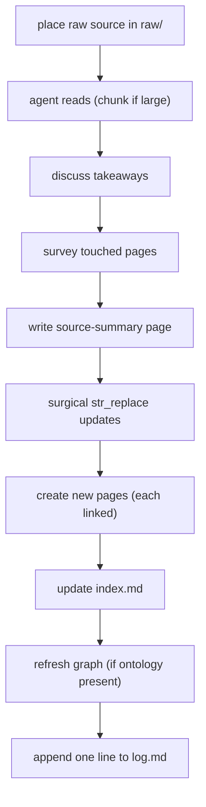
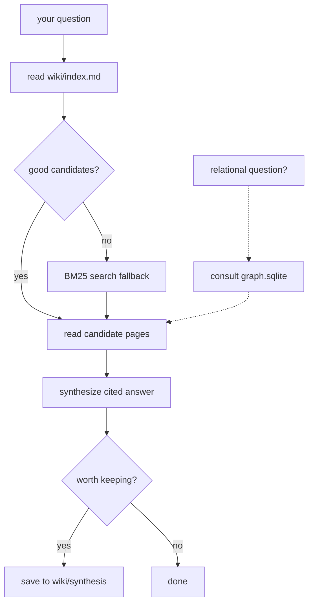

<!-- Adapted from: docs/workflows.html (source: skills/info-hive/references/{ingest-workflow,query-workflow,lint-workflow}.md). -->

# ワークフロー

wiki の基本操作は 3 つあります。[ソースの取り込み](#ソースを取り込む)、[wiki へのクエリ](#wiki-にクエリする)、[lint による点検](#lint-で健全性を確かめる)です。

> これらの操作は、コマンド（`/wiki:ingest`、`/wiki:query`、`/wiki:lint`）でも自然な言葉でも実行できます。記録の管理はエージェントが行います。ユーザーの役目は、ソースを選び、いくつかの質問に答え、編集を承認することです。

## ソースを取り込む

新しいソースが届いたら、次の順序で取り込みます。各手順の結果を、次の手順で使います。



1. **raw ソースを置きます。** ファイルを `raw/` に置きます。ファイル名は内容が分かるものにし、元の拡張子を付けます。日本語の題名には、`インボイス制度の手引き-2023.pdf` のような日本語のファイル名を使えます。英字は小文字にしてハイフンでつなぎ、空白は使いません。Web ページは URL を渡せば `wiki_fetch.py` が本文を `.md` にして保存し、日本語でなければエージェントが訳して画像に補足を書きます。PDF は `.pdf`、文字起こしは `.md` か `.txt` にします。このスラッグが、ソースの要約ページのスラッグになります。
2. **エージェントが読みます。** 短いソースは一度に読みます。長いソース（約 30 ページを超える論文、書籍の章、数時間分の文字起こし）はセクションごとに分割して読み、wiki の作業でコンテキストウィンドウがあふれないようにします。
3. **要点を話し合います。** エージェントが、目立った点、意外だった点、既存のページとつながる点を3〜4文で示します。ユーザーの返答に合わせて編集内容を決めます。たとえば「手法は省いて、結果だけでよい」「これは X のページと矛盾するので、指摘しておいて」と伝えられます。人が介在しないバッチモードではこの手順をスキップし、編集は控えめにします。
4. **エージェントが関係するページを調べます。** インデックスと候補のページを読み、更新するページ、新しく作るページ、指摘すべき矛盾の一覧を作ります。この調査によって、重複したページができるのを防ぎます。
5. **ソースの要約ページを書きます。** `wiki/sources/` に、主な主張、手法、結論、未解決の問いを書き、最後に `[[wikilinks]]` を並べた「関係するページ」のセクションを置きます。ソース全体を言い換えたものではなく、要約です。その直前の「取り込んだ内容と載せたページ」のセクションには、手順 6 と 7 のあとで、抜き出した主張ごとに、どのページへ送ったか（`create`、`update`、`source_only`）と理由を表で残します。
6. **関係するページを必要な箇所だけ更新します。** 全体を書き直すのではなく、`str_replace` を使います。裏づけが得られた内容には出典を加えます。矛盾する内容には、両方のソースを示す「Contradictions」の注記を目立つ位置に付けます。矛盾があるまま、内容を無断で上書きすることはありません。
7. **新しいページを作ります。** ページを作るに値する新しいエンティティやコンセプトについて作り、どのページにも frontmatter、本文、少なくとも1つの被リンクを付けます。どこからもリンクされていないページは、lint の検出結果にとどまらず、バグとして扱います。
8. **インデックスを更新します。** 新しいページごとに1行を追加します。`index.md` が 300 行を超えたら、インデックスを分割する時期です。詳しくは[スケーリングの閾値](./commands.md#wikistats)を参照してください。
9. **グラフ層を更新します。** `wiki/graph/ontology.yaml` がある場合に限ります。型付きエッジは、ソースが明示的に裏づけている場合に限って追加します。ページを作成または更新したら、型付きエッジの追加の有無にかかわらず、extract でグラフを作り直します。本文の wikilink や `sources:` からもエッジが生成されるためです。詳しくは[グラフ層のガイド](./graph.md)を参照してください。
10. **ログに1行追記します。** エージェントは、何をしたかをユーザーに伝えます。更新したページ、作成したページ、指摘した矛盾、追って調べる価値のある点を報告します。

## wiki にクエリする

目的は、ユーザーの質問に wiki をもとに出典つきで答えることと、残す価値のある回答をシンセシスのページとして wiki に保存することです。



1. **最初にインデックスを読みます。** 必ず `wiki/index.md`（または該当する分割済みのインデックス）から始めます。ページごとに簡潔な要約が1行あれば、たいていはそれで候補を見つけられます。
2. **候補のページを絞り込みます。** 候補は短く、厳選した一覧にします。1 つの質問に答えるときは、30 ページをまとめて読む前に候補を絞ります。インデックスの要約だけでは候補を絞れない場合、エージェントはローカルのハイブリッド検索を実行します。

   ```bash
   uv run --script skills/info-hive/scripts/wiki_search.py \
     "your query terms" --top 10 --json
   ```

   FastEmbed によるセマンティック検索の順位と BM25 の順位を、ローカルで統合します。絞り込むには `--type concept`、`--tag <tag>`、`--since YYYY-MM-DD` を付けます。依存パッケージを使わない語彙ベースの検索にしたい場合は、`uv run --script` の形ではなく `python skills/info-hive/scripts/wiki_search.py "your query terms" --no-embed` を実行します。詳しくは[検索](./search.md)を参照してください。
3. **関係を問う質問ではグラフを参照します。** 「X とつながっているものは？」「Y を提案したのは誰？」「A → B の経路をたどって」のような質問で、`graph.sqlite` がある場合に使います。グラフは読むページを選ぶために使い、それだけを証拠にすることはありません。
4. **候補のページを読みます。** ページは全体を読み、有望な `[[wikilinks]]` をたどります。すべてのリンクを再帰的に追いかけることはしません。
5. **必要ならバックリンクを調べます。** 「X はどこで言及されているか」という質問では、ページそのものより、そのページへの被リンクのほうが役に立つことが多いです。

   ```bash
   python skills/info-hive/scripts/wiki_search.py "" --backlinks <slug>
   ```
6. **回答をまとめます。** エージェントは自分の言葉で回答を書き、`[[wikilink]]` で出典を示します。矛盾がある場合は、どちらか一方を選んで片づけず、矛盾をそのまま示します。wiki に関係する内容がなければそうはっきり伝え、取り込むとよいソースを提案します。回答は確認できた根拠の範囲にとどめます。
6b. **確信度を示します。** 回答の終わりに、wiki がその回答をどれだけ裏づけているかを、確信度（confidence）の「高」「中」「低」と理由で示します。前提を元の資料で確かめたか、結論に判断を加えたか、仮説や矛盾、古い記述に頼っていないか、検索が縮退していなかったかで決まります。「中」か「低」なら、上げる方法（取り込むとよい資料、確かめるページ）を提案します。wiki に関係する内容がなければ、確信度は付けず、wiki の外の知識で答えを添えることもしません。質問の一部だけを wiki が扱っていないときも、その部分は外の知識で埋めません。
7. **wiki への保存を提案します。** 回答が新しいつながりを見いだしたものであれば、エージェントは `wiki/synthesis/` への保存を提案します。保存しておけば、次に関連する質問が来たときに役立ちます。あとで使う必要がなければ、保存を断れます。確信度が「低」の回答は、保存を提案しません。保存したシンセシスのページは根拠に数えないので、保存しても確信度は上がりません。

## lint で健全性を確かめる

定期的に行う健全性のチェックです。操作のたびに行う必要はありません。一定の間隔で行います。構造の確認（スクリプトが行う）と、内容の確認（エージェントがページを読んで行う）に分かれます。

1. **構造の lint を実行します。**

   ```bash
   python skills/info-hive/scripts/wiki_lint.py wiki/
   ```

   孤立ページ、リンク切れの wikilink、大きすぎるページ、frontmatter の問題、更新の止まったページ、重複したスラッグを報告します。グラフ層があれば、`wiki_graph_lint.py` も実行されます。
2. **検出結果をエージェントと一緒に仕分けます。** 検出結果には、それぞれ修正案が付きます。たとえば、孤立ページは適切な親ページからリンクし、リンク切れは修正するか削除します。大きすぎるページは分割し、欠けている frontmatter は追加します。更新が止まったページの更新や、重複したスラッグの統合も提案します。修正は、ユーザーが 1 件ずつ承認してから適用します。
3. **内容を確認します。** エージェントは、最近更新された約 10 ページと、もっとも多くリンクされているハブページを読みます。古いページとの矛盾や、ページ内の食い違いを探します。複数のページに登場するのに、専用ページがないコンセプトも探します。ハブページは次のコマンドで見つけます。

   ```bash
   python skills/info-hive/scripts/wiki_search.py "" --top-linked 10
   ```
4. **足りていない点を挙げます。** 多くのページに出てくるのに専用のページがない名前は、独立したページにする候補です。

   ```bash
   python skills/info-hive/scripts/wiki_lint.py wiki/ --suggest-pages
   ```
5. **インデックスを更新します。** 追加、名前変更、削除したページについてインデックスを更新し、`log.md` に要約を1行追記します。

> **頻度**
>
> 妥当な既定値は、構造の lint を取り込み 5 回ごと、内容の lint を毎週または取り込み 20 回ごと、足りない点の洗い出しを毎月です。lint のレポートが仕分けられる速さより早く増えていくなら、lint の頻度を上げるか、スキーマを見直す時期です。

## 経験の記録とスキルの改善

完了したタスクは、`/wiki:learn` で変更不可の経験のソースと、再利用できるコンセプトのパターンにできます。`/wiki:evolve` は、回数に上限のある学習とパターンの統合を行い、スキル全体の変更を提案し、検証の結果で候補を選び、固定した選定結果を独立した最終テストで測定します。失敗した実験も残し、承認された変更を明示的に適用またはロールバックします。通常の事実情報としての wiki はそのまま使えます。ワークフロー全体、実行できるパイロット、評価の範囲については、[経験の記録とスキルの改善](./evolution.md)を参照してください。
