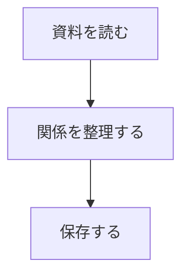

# ページの概要を作る

`wiki_overview.py prepare` が返す `page_copy` を入力とする。読むのはこのページの写しだけである。
ページにない事実を足したり、リンク先のページを読んで内容を加えたりしない。

## 目的

SVG と Mermaid を使って、このページの内容を理解しやすいようにしてください。重要な詳細を省くことなく、大きな画像と簡潔な文章で説明してください。独自のセンスを活かし、手抜きなデザインは避け、必要に応じてアイコンとビジュアルを組み込んでください。写真は使いません。利用できるスキルの一覧に、図を作るスキルがあって用途に合うものだけを、厳選して使ってください。文章や詳細を記述する際は、明確かつ簡潔・端的にし、専門用語は避けてください。閲覧者がこの分野の初心者であるかのように説明してください。

## 下書きの形

`draft_dir` の直下に、frontmatter のない `overview.md` と、参照する `<名前>.svg` を Write ツールで置く。
名前は半角の英小文字・数字から始め、その後も英小文字・数字・ハイフンだけを使い、40文字以下にする。
SVG は12個以下、1つ2 MiB以下、本文は UTF-8 で64 KiB以下、組み立てた概要は8 MiB以下にする。

- 見出しは `###` 以下にする。
- wikilink は書かない。
- SVG は `` で参照する。ファイルパスや外の URL を画像の行き先にしない。
- Mermaid は `mermaid` のフェンスに書く。コードフェンスは閉じる。
- `svg-figure` のフェンスや frontmatter は自分で書かない。スクリプトが組み立てる。
- 本文と SVG のほかのファイル、下位のディレクトリ、リンクは置かない。

`overview.md` の例：

````markdown
### 全体の流れ

資料を読み、関係を整理してから保存します。



````

この例では `flow.svg` も置く。SVG は、名前空間 `http://www.w3.org/2000/svg` を持ち、最後まで閉じた XML にする。
根の `width` と `height`、または `viewBox` で大きさを決める。DTD と実体の宣言は使わない。

## 図を書くときの目安

図は幅720を基準にし、図の中の文字は13以上にする。図に明るい背景を付け、暗い配色でも文字と線を読めるようにする。
Mermaid は縦に流す。SVG の `<foreignObject>` と外部の参照は使わない。
図を作るスキルの出力も、この下書きの形に合わせる。

何を図にするか、どう言い換えるかはページの内容に合わせて決める。
検査が通っても中身の正しさは確認されないので、ページにない説明や、読み違えた数値がないかを自分で照らす。
