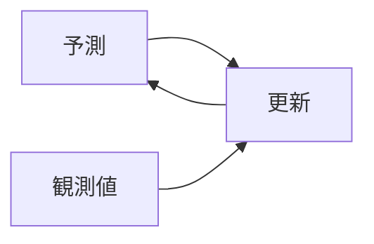

# ページの規約

wiki のすべてのページが従う構造上の規則である。特定の wiki では、スキーマでこれらを拡張したり上書きしたりできるが、既定ではこの規則に従う。

この wiki は日本語で書くことを前提にしている。本文、題名、ファイル名は日本語でよく、技術用語や固有名詞は英語のまま混ぜてよい。ただし、スクリプトが字句どおりに読む文字列（frontmatter のキー、`type` と `kind` の値、日付の形式、wikilink の書き方）は、下に書く形を守る。ソースのページの `## 主張と行き先` の表に書く行き先（`create`、`update`、`source_only`）も、英語の識別子のまま書く。

## frontmatter

wiki のページはどれも YAML の frontmatter で始める。必須のフィールドは次のとおりである。

```yaml
---
type: "concept"
title: "消費税"
tags: ["税制", "間接税"]
sources: ["消費税法の概要", "インボイス制度の手引き"]
created: 2026-04-15
updated: 2026-04-15
---
```

文字列の値は、配列の要素も含めて、すべて二重引用符で囲む。`type` や `kind` のような決まった英語の値も囲む。`YYYY-MM-DD` の日付と数値は囲まない。日時（`fetched_at` のように時刻を含むもの）は文字列として囲む。値の中の `"` は `\"`、`\` は `\\` と書く。引用符の外の `#` から行末まではコメントとして読まれず、引用符の中の `#` と `,` は値の一部になる（`authors: ["Smith, J."]` は 1 つの要素である）。引用符のない文字列は lint が指摘する。

キーと `type` の値は英語で書く。`type: <source|entity|concept|synthesis|...>` のどれかである。スクリプトは日本語の別名（`タイトル`、`種類`、`概念` など）も読めるが、エージェントが書くときは英語を使う。別名の一覧は `SCHEMA.md` の「日本語の別名」にある。

frontmatter のリストの値は `[[wikilinks]]` ではなく、**そのままのスラッグ**である点に注意する。二重角括弧の書き方は、ページの本文でだけ使う。付属のスクリプトは、frontmatter の `sources:`、`entities:`、`concepts:` のリストをスラッグへの参照として扱い、本文の wikilink と同じように解決する。

frontmatter を日本語で書くときは、次の4点を守る。どれも lint が指摘する。

- キーのあとは半角の「:」にする。全角の「：」はキーの区切りとして読まれない。
- リストの区切りは半角の「,」にする。`tags: ["税制、間接税"]` のように「、」で区切ると、1つの項目になる。
- 1つのページに、同じキーの英語と別名の両方を書かない（`title` と `タイトル` など）。
- 文字列の値は二重引用符で囲む。日本語の値も同じである（`title: "消費税"`、`tags: ["税制"]`）。

`type` は、ページの種類と、ページを置くサブディレクトリを決める。標準の種類は `source`、`entity`、`concept`、`synthesis` である。スキーマで種類を追加できる。

`title` は人が読むための名前である。日本語の資料や概念なら日本語で書き、英語の固有名詞は英語のまま書く（`"Attention Is All You Need"`）。人の名前は、ふつうに書く順で書く。日本人なら「山田 太郎」のように姓、名の順にし、欧米の人なら原語の綴りで「Andrej Karpathy」と書く。カタカナの表記（「アンドレイ・カルパシー」）や旧姓、略称は `aliases:` に入れる。

`tags` は階層のないリストである。タグは、`wiki_search.py` が絞り込みに使い、ユーザーが Obsidian で話題ごとにたどるのに使う。スクリプトはタグを NFKC にそろえてから比べるので、全角の「ＡＩ」と半角の「AI」は同じタグになる。それでも、書くときは半角の英数字にそろえる。日本語のタグと英語のタグ（`税制` と `tax`）は別のタグなので、どちらを使うかをスキーマで決める。タグの体系は小さく、規律正しく保つ。タグが 200 個ある wiki は、事実上タグがないのと同じである。スキーマで正式なタグの一覧を定め、lint のスクリプトがそれ以外のタグに警告を出すようにする。

`sources` は、このページの元になったソースの要約ページのリストである。エンティティ、コンセプト、シンセシスのページでは必ず埋める。ソースのページ自体では、このフィールドを省く（ソースのページがソースそのものだからである）。

`created` と `updated` は `YYYY-MM-DD` の形の日付である。「2026年4月15日」「2026/04/15」「令和8年4月15日」のような書き方は日付として読まれず、lint が指摘する。`updated` は、lint での更新の止まったページのチェックと、「新着」の表示に使われる要のフィールドである。

種類ごとのフィールドは次のとおりである。
- ソースのページには、`authors`、`url`、`raw`（raw ファイルへのパス）、`ingested`（`YYYY-MM-DD`）を加える。
- エンティティのページには、`aliases`（同じエンティティの別名や表記の違い）、`kind`（`person`、`paper`、`product` など）を加えてもよい。
- シンセシスのページには、`question`（クエリから保存した場合は、元の質問）、`asked`（質問した日付）、`sources_consulted` を加えてもよい。`sources` にはソースの要約ページだけを入れ、`sources_consulted` には種類を問わず参照したページ（コンセプト、エンティティ、ほかのシンセシスを含む）を入れる。

## wikilink

相互参照には `[[page-slug]]` の書き方を使う。スラッグは、`.md` の拡張子とディレクトリの接頭辞を除いたファイル名で、Obsidian と同じ形式である（`[[消費税]]`、`[[kalman-filter]]`）。別名を表示することもでき、`[[消費税|消費税の仕組み]]` と書く。同じスラッグの区別が要るときは、`[[concepts/消費税]]` のようにディレクトリを付ける。ディレクトリを付けたリンクは、そのパスのページがあるときだけ解決する。

区切りの `|` と `#` は半角で書く。全角の「｜」や「＃」は区切りとして扱われず、`[[消費税｜税]]` は「消費税｜税」という名前のページへのリンクになる。lint が指摘する。

リンクの照合は大文字と小文字を区別する。`[[Kalman-Filter]]` は `kalman-filter.md` に解決しないので、スラッグに書いたとおりに書く。

どのページにも、少なくとも1つの被リンクがあるべきである。被リンクのない新しいページは孤立ページであり、lint で指摘される。

付属の `wiki_search.py --backlinks <slug>` は被リンクを返す。手作業で探すには次のようにする。

```bash
grep -rln "\[\[<slug>" wiki/
```

grep は、表示名やディレクトリの付いたリンクの一部と、macOS が NFD で保存したファイルの中のリンクを取りこぼすことがある。正確な一覧が要るときはスクリプトを使う。

## ページの大きさ

大きさは、空白（改行を含む）を除いた文字数と、行数の両方で測る。日本語も英語も、1文字を1と数える。

**目安（ソフト上限）: 10,000 文字または 100 行。** ページがこれに近づいたら、分割すべきかを検討する。

**上限（ハード上限）: 25,000 文字または 200 行。** これを超えるページは必ず分割する。lint のスクリプトが違反を指摘する。

コードフェンス（mermaid の図を含む）の中身と、画像だけの行は数えない。上限は文章の密度を見るためのもので、図のソースの長さは別の問題だからである。図の直後の説明は数える。

文字数で測るのは、日本語の段落は空白で語を区切らず、1つの段落を改行せずに書くことも多いからである。語数や行数だけでは、長い日本語のページを見逃す。値は wiki ごとに `SCHEMA.md` で変えてよく、lint には `--soft-char-cap` と `--hard-char-cap` で渡す。

アトミックさの目安: 1つのページは*1つ*のことを扱う。「消費税」のページが「インボイス制度」のページを兼ねてはならない。それらは相互参照し合う2つのページである。「## 軽減税率」の下に中身のある小見出しを5つも書いているなら、それらの小見出しはおそらく独立したページにすべきである。

大きさに上限を設けるのは、コンテキストのボトルネックの原則のためである。1回に読むページの大きさに上限があるので、LLM はコンテキストを使い果たす心配をせずに、いくつかのページを読める。

## 命名

ページのスラッグ（ファイル名）には日本語を使ってよい。ページの題名が日本語ならスラッグも日本語にし、英語の固有名詞や技術用語のページは英語のスラッグにするのを基本にする。ディレクトリと対応させ、コンセプトのページは `wiki/concepts/<slug>.md` に置く。

スラッグは次の規則で付ける。

- 英字は小文字にし、英単語の間はハイフンでつなぐ（`kalman-filter.md`）。
- 空白は使わない。日本語の語の間にも入れない（`機械学習の評価.md`）。英語と日本語が混ざる名前は、境目に記号を入れずにつなぐ（`rag評価.md`）。
- 次の文字は使わない。Windows でファイル名に使えない `\ / : * ? " < > |`、wikilink の区切りになる `# | [ ] ^`、全角の「｜」と「＃」。
- 全角の英数字と半角のカタカナは使わない（`ＡＩ.md` ではなく `ai.md`）。
- 別のディレクトリでも、同じスラッグを使わない。ページはスラッグで識別するので、lint が重複を指摘する。

スクリプトは、ファイル名とリンク先を NFC にそろえてから比べる。macOS は濁点の付いたファイル名を NFD（「カ」と「゛」の2文字）で返すが、NFC で書いたリンクと一致する。

日本語と英語のどちらの名前にするか迷うページ（「機械学習」と `machine-learning` など）の扱いは、wiki ごとにスキーマで決め、同じ wiki の中ではそろえる。選ばなかったほうの表記は `aliases:` に入れる。

人についてのエンティティのページ: 姓だけでなく、フルネームのスラッグにする。日本人なら `山田太郎.md`、欧米の人なら `andrej-karpathy.md` にする。よく使われる短い呼び名やカタカナの表記は、frontmatter の `aliases:` に加える。

ソースのページ: ソースの題名から作ったスラッグを使い、区別のために年を付けてもよい（`インボイス制度の手引き-2023.md`、`attention-is-all-you-need-2017.md`）。題名が長いときは、意味の分かる範囲で短くする。できれば、ソースのページのスラッグを raw ファイルの名前と一致させる（`raw/インボイス制度の手引き-2023.pdf`）。こうすると、raw ファイルへの参照が簡単になる。

シンセシスのページ: 日付ではなく、質問か話題から名前を付ける。`2026-04-15-質問.md` ではなく、`ragとllm-wikiの比較.md` や `軽減税率の対象の比較.md` にする。日付の名前は、インデックスで見ても役に立たない。

## 本文の構成

本文には決まったテンプレートはない（スキーマで、特定のページの種類にテンプレートを決めてもよい）。ただ、既定として次の構成がうまく機能する。見出しは日本語で書いてよい。

**ソースのページ**: ソースの主な貢献を要約するリード文で始める。主な主張、手法（関係する場合）、結論、未解決の問いのセクションを置く。その次に「## 主張と行き先」のセクションを置き（下の「ソースのページの主張と行き先」）、最後に「## 関係するページ」のセクションを置き、このソースが関係するエンティティとコンセプトのページを並べる。

**エンティティのページ**: エンティティを定義するリード文で始める。関係する属性のセクションを置く（論文なら著者、発表の場、主な主張。人なら所属、主な業績。製品なら何をするものか、誰が作っているか）。「言及しているページ」のセクションは不要である。被リンクを探せば分かるからである。

**コンセプトのページ**: コンセプトをはっきり定義するリード文で始める。主な定式化、派生形、議論のある点、関係するコンセプトのセクションを置く。`[[wikilinks]]` を多く使うのがふつうである。コンセプトのページは、wiki の各部分をつなぐ役割を果たす。

**シンセシスのページ**: 質問（クエリから保存した場合）か、問題の設定から始める。本文は回答や分析である。最後に、参照したソースを wikilink で並べる。

### ソースのページの主張と行き先

ソースのページには、取り込みで抜き出した主張ごとに、どのページへ送ったかを表で残す。何を独立したページにし、何をソースの要約ページだけに残したかを、あとで確かめられるようにするためである。見出しと列は次の形にそろえる。書き方と作例は `ingest-workflow.md` の手順 7b にある。

```markdown
## 主張と行き先

| 候補 | 主張と成り立つ条件 | 根拠の位置 | 行き先 | 理由 |
| --- | --- | --- | --- | --- |
```

| 行き先 | 意味 |
| --- | --- |
| `create` | 取り込みで新しいページを作り、主張を載せた |
| `update` | 既存のページに主張を足した。既存の主張に出典を加えただけのときも含む |
| `source_only` | ソースの要約ページだけに残し、ほかのページには載せなかった |

- 行き先の値は英語の識別子のまま、1 つのセルに 1 つだけ書く。
- `create` と `update` の理由には、作ったページか更新したページを `[[スラッグ]]` で書く。`source_only` の理由には、ほかのページに載せなかった理由を書く。
- 主張には、時期、対象、前提のような成り立つ条件を省かずに書く。根拠の位置は、節の見出し、PDF のページ番号、行の範囲のように、原本を開いて探せる形で書く。
- 表は取り込みで実際にしたことの記録である。表のためにページを作ったり更新したりしない。
- 表の中の wikilink は `[[スラッグ]]` の形だけにする。別名を付けた `[[スラッグ|表示名]]` は、`|` が表の列の区切りになり、表が崩れる。
- 表もページの大きさに数える。セルは短く書く。

## 図表

図表で説明できる内容（流れ、順序、状態、関係、時系列、比較）は、文章に加えて図表を入れる（ADR-0005）。図表は次の形で書く。

| 種類 | 書き方 |
| --- | --- |
| 流れ、順序、状態、関係、時系列 | mermaid のコードブロックを本文に書く |
| mermaid で描けない図（箱の配置を示すアーキテクチャの図など） | svg を書いて `wiki/assets/<ページのスラッグ>-NN.svg` に置き、本文から `` で参照する |
| 比較 | Markdown の表 |

````markdown


> Claude Fable 5.1 補足: カルマンフィルターの 1 回の繰り返しを示す。予測の結果と観測値から更新し、更新の結果が次の予測の入力になる。
````

- **説明を添える。** 図表の直後に `> <モデルの表示名> 補足: ` で始まる引用ブロックを置き、図表を見なくても内容が分かるように書く。取り込んだ画像の補足と同じ形である。検索は図の中身を文章として拾えないので、この説明が索引に入る。表示名は推測しない。
- **図の中の文字は日本語にする。** 識別子だけ英語のままにする。
- **svg の参照はページからの相対パスで書く。** 知識ページは `wiki/<種類>/` にあるので、`wiki/assets/` の svg は `../assets/<ページのスラッグ>-NN.svg` で指す。`assets/...` と書くと `wiki/<種類>/assets/` を指し、GitHub、VS Code、Obsidian で表示されない。lint は参照先をページの位置から解決し、見つからなければ `missing_assets` として指摘する。
- **画像の参照は標準の `` で書く。** Obsidian の埋め込み `![[x.svg]]` は wikilink として扱われ、リンク切れとして指摘される。
- **png などのラスター画像は使わない。** 差分が読めず、モデルが描き直せない。
- **Web ページから取り込んだ画像は `wiki/` に写さない。** `raw/assets/` に保存した画像（svg を含む）は信頼しない入力として扱い、知識ページの図は自分で描く。
- **描く手段。** 利用できるスキルの一覧に図表を作るスキルがあれば、用途に合うものを使い、出力を上の形に直して説明を添える。なければ mermaid か svg を直接書く。特定のスキルがあることを前提にしない。

コードフェンス（mermaid を含む）の中身と、画像だけの行は、ページの大きさに数えない。図の直後の説明は数える。

## 引用の書き方

本文は言い換えで書き、引用は、正確な言い回しが重要な短い表現に限る。引用するときは「」で囲み、どのソースの言葉かを示す（「[[<ソースのスラッグ>]] は、X を『<ソースの言い回し>』と定義している」）。英語のソースは英語のまま引き、必要なら訳を添える。

Web ページから取り込んだソースは、`raw/` に置いた訳文から引く（`translated_by` が空でなければ訳文である）。原文は保存していないので、原文の英語を思い出して引いてはならない。

グラフの `evidence` や、判定レイヤーと評価ループの根拠に使う引用は、ソースの文をそのまま写す。言い換えたり訳したりすると、照合で一致しなくなる。照合では、大文字と小文字の違いと、日本語の文字どうしの間の改行や空白は吸収するが、英数字の間の空白は残す。全角と半角の違いは吸収しないので、ソースが「ＡＩ」なら引用も「ＡＩ」と書く。引用は1文か文の一部にとどめる。文は「。」「！」「？」で区切られる。

## Web ページの raw の frontmatter

`wiki_fetch.py` が `raw/<スラッグ>.md` に書く frontmatter の項目は次のとおりである。これは raw の原本の記録で、wiki のページの frontmatter ではない。

| キー | 内容 |
| --- | --- |
| `url` | 取得した URL |
| `final_url` | リダイレクトのあとの URL。`url` と違うときだけ書く |
| `title` | ページの題名（本文の `<h1>`、なければ `<title>`） |
| `fetched_at` | 取得した日時。タイムゾーンつきの ISO 8601 を文字列として引用符で囲む |
| `source_sha256` | 原文の SHA-256 |
| `source_sha256_of` | ハッシュを何に対して取ったか。スクリプトが取った HTML なら `"html"`、ブラウザで取った本文なら `"dom"` |
| `source_lang` | 原文の言語（`<html lang>`）。なければ `""` |
| `translated_by` | 訳したモデルの表示名。訳していなければ `""` |
| `fetched_by` | 取得に使ったスクリプトと版 |

## 留保の書き方

wiki のほかのソースで裏づけられていない主張をソースがしている場合は、留保を付ける。「ソース X は Y と主張しているが、wiki のほかのソースではまだ裏づけられていない」のように書く。wiki にソースが増えるにつれて、lint で留保付きの主張を見直し、確認済みに格上げするか、議論があるものとして指摘する。

2つのソースが矛盾する場合は、両方を書く。「ソース X は Y と主張し、ソース Z は Y ではないと主張している。この矛盾は解決していない」のように書く。黙ってどちらか一方を選んではならない。

## ページの語り口を中立に保つ

wiki は LLM の語り口で書く。ソースの著者の語り口でも、ユーザーの語り口でもない。正確な言い回しが重要な、短く要となる表現を除いて、引用ではなく言い換えで書く。文体はである調にそろえ、Wikipedia の記事のような、中立で百科事典的な文体を保つ。
